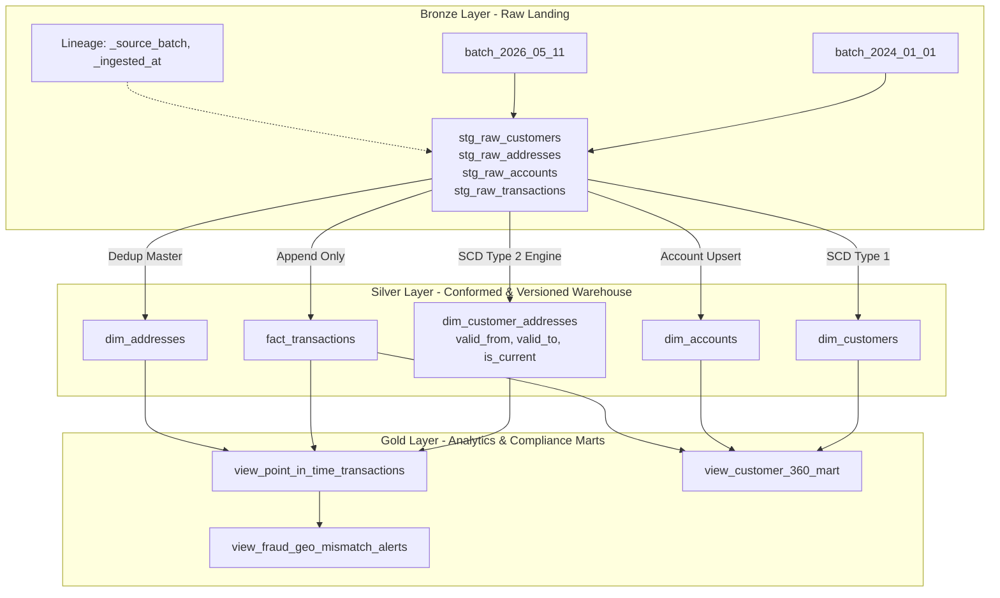

# ⏳ Chronos: Point-in-Time Temporal Data Warehouse (SCD Type 2)

[](#)
[-emerald.svg)](#)
[](#)
[-brightgreen.svg)](#)

An enterprise-grade Banking Data Engineering pipeline implementing **Slowly Changing Dimensions (SCD Type 2)**, **Point-in-Time audit joins**, and automated **Geographic Fraud Anomaly Detection** using the **Medallion Architecture**.

---

## 📌 Executive Summary & Problem Statement

In core banking systems, customers frequently change physical addresses, phone numbers, branch affiliations, and KYC risk ratings.
* **The Naive Flaw:** Storing addresses directly in a flat `customers` table causes in-place overwrites (`UPDATE customers SET city = 'Bangalore'`).
* **The Business Impact:** When regulatory audits (e.g., RBI, FinCEN) or fraud investigations examine a historical transaction (e.g., a cash withdrawal in Udupi in 2024), naive systems falsely report that the customer lived in Bangalore at that time. This destroys point-in-time auditability and breaks downstream machine learning features.
* **The Solution:** A decoupled temporal data pipeline that versions dimensional relationships using **SCD Type 2** (`valid_from`, `valid_to`, `is_current`), maintaining an immutable audit ledger across all customer lifecycles.

---

## 🏗️ System Architecture (Medallion Pattern)



---

## ⚙️ Key Technical Features

### 1. SCD Type 2 Temporal Versioning
When Customer `C101` relocates from **Udupi** to **Bangalore**:
1. The active record is retired: `valid_to = '2026-05-11 00:00:00'`, `is_current = 0`.
2. A new record is generated: `valid_from = '2026-05-11 00:00:00'`, `valid_to = NULL`, `is_current = 1`.
3. Permanent addresses and communication addresses are tracked independently using `address_type`.

**Live Warehouse Snapshot:**
| customer_address_id | customer_id | city | address_type | valid_from | valid_to | is_current | Status |
| :---: | :---: | :---: | :---: | :---: | :---: | :---: | :--- |
| `1` | C101 | **Udupi** | COMMUNICATION | `2024-01-01` | `2026-05-11` | `0` | 🟡 Historical |
| `5` | C101 | **Bangalore** | COMMUNICATION | `2026-05-11` | `NULL` | `1` | 🟢 Current Active |
| `2` | C101 | **Udupi** | PERMANENT | `2024-01-01` | `NULL` | `1` | 🟢 Current Active |

### 2. Point-in-Time (PIT) Temporal Range Join
Transactions are enriched using non-equi joins between transaction timestamps and address validity windows:
```sql
SELECT t.transaction_id, c.customer_name, a.city AS registered_city_at_txn_time
FROM fact_transactions t
JOIN dim_customer_addresses ca 
    ON t.customer_id = ca.customer_id
   AND ca.address_type = 'COMMUNICATION'
   AND t.txn_timestamp >= ca.valid_from
   AND (t.txn_timestamp < ca.valid_to OR ca.valid_to IS NULL)
JOIN dim_addresses a ON ca.address_id = a.address_id;
```

### 3. Automated Fraud / Geo-Mismatch Detection
Flags high-risk transactions where a physical card swipe or ATM withdrawal occurred in a geography mismatched from the customer's active residence at that timestamp:
* Transaction `TXN20260520999` (₹80,000 ATM withdrawal in **Kolkata**) flagged as `HIGH_RISK_GEO_MISMATCH` because customer was registered in **Bangalore** on that date.

---

## 🧪 Automated Data Quality & Integrity Suite

The pipeline executes 4 automated integrity assertions:
- **Test 1: SCD Type 2 Single-Active Uniqueness:** Ensures no entity has $>1$ active row per address type.
- **Test 2: Temporal Consistency:** Asserts `valid_from < valid_to` for all expired records.
- **Test 3: Referential Integrity:** Confirms zero orphan transactions across dimensions.
- **Test 4: Metric Completeness:** Guarantees non-null transaction amounts and authorization timestamps.

---

## 🚀 How to Run the Pipeline

### Prerequisites
- Python 3.8+
- SQLite3 (built into Python standard library, zero external pip packages needed)

### Execute End-to-End Pipeline
```bash
python3 main.py
```

---

## 📁 Repository Structure
```
Data/
├── README.md                               # Project documentation & design specification
├── main.py                                 # Master pipeline orchestrator
├── data/
│   ├── bronze/                             # Raw batch files (batch_2024_01_01, batch_2026_05_11)
│   ├── silver/banking_warehouse.db         # Clean relational & dimensional warehouse
│   └── gold/                               # Exported business CSV reports & audit marts
├── sql/
│   ├── 01_ddl_schema.sql                   # Database DDL with primary/foreign/surrogate keys
│   ├── 02_scd2_merge.sql                   # Pure SQL patterns for SCD Type 1 & Type 2
│   └── 03_gold_queries.sql                 # Point-in-Time, Fraud Detection, and Customer 360 views
└── src/
    ├── generator/generate_mock_data.py     # Generates multi-batch core banking data
    ├── ingestion/ingest_bronze.py          # Ingests raw files into staging with audit metadata
    ├── transforms/scd2_engine.py           # Core SCD Type 2 and Silver transformation engine
    ├── analytics/generate_gold_reports.py  # Exports Gold layer marts to CSV
    └── quality/data_quality_tests.py       # Automated data quality & integrity test suite
```

---

## 📄 Resume Project Description (Copy-Paste Ready)

**Point-in-Time Banking Data Warehouse & SCD Type 2 Pipeline**  
*Technologies: Python, SQL, Medallion Architecture, SQLite, Data Modeling, ELT*
* Engineered an end-to-end banking data pipeline processing multi-batch extracts across Bronze, Silver, and Gold layers with full temporal auditability.
* Implemented **Slowly Changing Dimensions (SCD Type 2)** logic to track customer demographic transitions across time without historical data loss, separating master entities from temporal junction tables.
* Designed complex **Point-in-Time (PIT) non-equi SQL joins** to reconcile historical transaction ledgers against active address windows for regulatory audits and automated **Geographic Anomaly / Fraud Detection**.
* Integrated an automated **Data Quality Test Suite** verifying SCD2 single-active constraints, chronological range validity, and zero-orphan referential integrity with 100% test pass rate.
